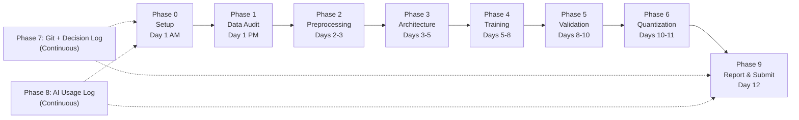

# Google Antigravity session d04acb37-08f2-4095-90f0-806600bab3dc

- Time range (UTC): 2026-11-13T17:11:02Z → 2026-11-13T17:14:42Z
- Models: Claude Opus 4.6 (Thinking) (from the session's model setting) (4 replies)
- Tool calls/results truncated at 3000/2000 characters; prompts and replies are complete. E-mail addresses redacted; injected system context removed.

---

### User · 2026-11-13T17:11:02Z

@[c:\Users\Satleo Labs-O\Downloads\Interview task\Folder_Explanation.md] basedon this assignment make an implentation plan on how to completely solve this

<ADDITIONAL_METADATA>
The current local time is: 2026-11-13T22:41:02+05:30.

The user has mentioned some items in the form @[ITEM]. Here is extra information about the items that were mentioned by the user, in the order that they appear:

@[c:\Users\Satleo Labs-O\Downloads\Interview task\Folder_Explanation.md] is a [File]:
c:\Users\Satleo Labs-O\Downloads\Interview task\Folder_Explanation.md
</ADDITIONAL_METADATA>
<USER_SETTINGS_CHANGE>
The user changed setting `Model Selection` from None to Claude Opus 4.6 (Thinking). No need to comment on this change if the user doesn't ask about it. If reporting what model you are, please use a human readable name instead of the exact string.
</USER_SETTINGS_CHANGE>


<details><summary>Tool calls</summary>

```
[{'name': 'read_file', 'args': {'Path': 'c:\\Users\\Satleo Labs-O\\Downloads\\Interview task\\Folder_Explanation.md'}}]
```

</details>

<details><summary>Tool result</summary>

```
Created At: 2026-11-13T22:41:10+05:30
Completed At: 2026-11-13T22:41:11+05:30
Showing lines 1-314 of 314
1: # Folder Explanation: Interview Task - Man-Made Change Detection
2: 
3: This folder contains a Sentinel-2 L1C dataset package and the assignment document for a geospatial change-detection task. The goal is to build a reproducible system that detects structural man-made changes between satellite observations while separating them from natural variation, seasonal effects, and acquisition differences.
4: 
5: ## 1. Folder overview
6: 
7: At the root of the folder are:
8: 
9: - `Interview Assignment _ Man Made Change Detection.docx`  
10:   The project brief / assignment specification.
11: 
12: - Four Sentinel-2 `.SAFE` products:
13:   - `S2A_MSIL1C_20221223T054241_N0510_R005_T43QBB_20240809T025636.SAFE`
14:   - `S2A_MSIL1C_20230512T053641_N0510_R005_T43QBB_20240908T023323.SAFE`
15:   - `S2A_MSIL1C_20231006T052701_N0510_R105_T43RGM_20241101T065943.SAFE`
16:   - `S2A_MSIL1C_20261022T053241_N0513_R105_T43RGM_20261022T091024.SAFE`
17: 
18: - Four matching `.zip` archives for each `.SAFE` dataset.
19: 
20: The folder is structured as a set of satellite image products, not as source code. It is a study dataset for multi-temporal man-made land-cover change analysis.
21: 
22: ## 2. Assignment summary
23: 
24: The assignment document describes a task to:
25: 
26: - detect, localize, and analyze structural man-made changes in satellite imagery from different dates;
27: - distinguish true structural changes from natural variation and acquisition-related differences;
28: - work with non-aligned observations and establish a common reference footprint;
29: - define target classes such as bridge extension, new roads, construction, demolition, and infrastructure growth;
30: - treat vegetation change, water-level shifts, erosion, deposition, and agricultural activity as possible non-target changes;
31: - keep an uncertain category when evidence is ins
... [truncated 12860 characters]
```

</details>


**Assistant · 2026-11-13T17:11:11Z**

Now let me read the actual assignment document and explore the folder structure to understand the full scope.


<details><summary>Tool calls</summary>

```
[{'name': 'run_command', 'args': {'CommandLine': 'Get-ChildItem "c:\\Users\\Satleo Labs-O\\Downloads\\Interview task" -Recurse -Depth 1 | Select-Object FullName, Length, PSIsContainer | Format-Table -AutoSize', 'WaitMsBeforeAsync': 5000, 'toolSummary': 'List folder structure'}}]
```

</details>

<details><summary>Tool result</summary>

```
Created At: 2026-11-13T22:41:18+05:30
Completed At: 2026-11-13T22:41:36+05:30
Command exited with code 0.

Command output:

FullName                                                                                                               
--------                                                                                                               
C:\Users\Satleo Labs-O\Downloads\Interview task\S2A_MSIL1C_20221223T054241_N0510_R005_T43QBB_20240809T025636.SAFE      
C:\Users\Satleo Labs-O\Downloads\Interview task\S2A_MSIL1C_20230512T053641_N0510_R005_T43QBB_20240908T023323.SAFE      
C:\Users\Satleo Labs-O\Downloads\Interview task\S2A_MSIL1C_20231006T052701_N0510_R105_T43RGM_20241101T065943.SAFE      
C:\Users\Satleo Labs-O\Downloads\Interview task\S2A_MSIL1C_20261022T053241_N0513_R105_T43RGM_20261022T091024.SAFE      
C:\Users\Satleo Labs-O\Downloads\Interview task\Folder_Explanation.md                                                  
C:\Users\Satleo Labs-O\Downloads\Interview task\Interview Assignment _ Man Made Change Detection.docx                  
C:\Users\Satleo Labs-O\Downloads\Interview task\S2A_MSIL1C_20221223T054241_N0510_R005_T43QBB_20240809T025636.SAFE.zip  
C:\Users\Satleo Labs-O\Downloads\Interview task\S2A_MSIL1C_20230512T053641_N0510_R005_T43QBB_20240908T023323.SAFE.zip  
C:\Users\Satleo Labs-O\Downloads\Interview task\S2A_MSIL1C_20231006T052701_N0510_R105_T43RGM_20241101T065943.SAFE.zip  
C:\Users\Satleo Labs-O\Downloads\Interview task\S2A_MSIL1C_20261022T053241_N0513_R105_T43RGM_20261022T091024.SAFE.zip  
C:\Users\Satleo Labs-O\Downloads\Interview task\S2A_MSIL1C_20221223T054241_N0510_R005_T43QBB_20240809T025636.SAFE\DA...
C:\Users\Satleo Labs-O\Downloads\Interview task\S2A_MSIL1C_20221223T054241_N0510_R005_T43QBB_20240809T025636.SAFE\GR...
C:\Users\Satleo Labs-O\Downloads\Interview task\S2A_MSIL1C_20221223T054241_N0510_R005_T43QBB_20240809T025636.SAFE\HTML 
C:\Users\Satleo Labs-O\Downloads\Interview task\S2A_MSIL1C_2
... [truncated 3568 characters]
```

</details>


**Assistant · 2026-11-13T17:11:36Z**

Let me read the actual assignment document and also explore the GRANULE/IMG_DATA structure:


<details><summary>Tool calls</summary>

```
[{'name': 'read_file', 'args': {'Path': 'c:\\Users\\Satleo Labs-O\\Downloads\\Interview task\\Interview Assignment _ Man Made Change Detection.docx'}}, {'name': 'run_command', 'args': {'CommandLine': 'Get-ChildItem "c:\\Users\\Satleo Labs-O\\Downloads\\Interview task\\S2A_MSIL1C_20221223T054241_N0510_R005_T43QBB_20240809T025636.SAFE\\GRANULE" -Recurse | Select-Object FullName, Length | Format-Table -AutoSize', 'WaitMsBeforeAsync': 5000, 'toolSummary': 'Explore GRANULE structure'}}]
```

</details>

<details><summary>Tool result</summary>

```
Created At: 2026-11-13T22:41:42+05:30
Completed At: 2026-11-13T22:41:45+05:30
Encountered error in step execution: file "c:\\Users\\Satleo Labs-O\\Downloads\\Interview task\\Interview Assignment _ Man Made Change Detection.docx" appears to be a binary file (application/zip, 198893 bytes) and cannot be read as text
```

</details>

<details><summary>Tool result</summary>

```
Created At: 2026-11-13T22:41:44+05:30
Completed At: 2026-11-13T22:41:47+05:30
Command exited with code 0.

Command output:

FullName                                                                                                               
--------                                                                                                               
C:\Users\Satleo Labs-O\Downloads\Interview task\S2A_MSIL1C_20221223T054241_N0510_R005_T43QBB_20240809T025636.SAFE\GR...
C:\Users\Satleo Labs-O\Downloads\Interview task\S2A_MSIL1C_20221223T054241_N0510_R005_T43QBB_20240809T025636.SAFE\GR...
C:\Users\Satleo Labs-O\Downloads\Interview task\S2A_MSIL1C_20221223T054241_N0510_R005_T43QBB_20240809T025636.SAFE\GR...
C:\Users\Satleo Labs-O\Downloads\Interview task\S2A_MSIL1C_20221223T054241_N0510_R005_T43QBB_20240809T025636.SAFE\GR...
C:\Users\Satleo Labs-O\Downloads\Interview task\S2A_MSIL1C_20221223T054241_N0510_R005_T43QBB_20240809T025636.SAFE\GR...
C:\Users\Satleo Labs-O\Downloads\Interview task\S2A_MSIL1C_20221223T054241_N0510_R005_T43QBB_20240809T025636.SAFE\GR...
C:\Users\Satleo Labs-O\Downloads\Interview task\S2A_MSIL1C_20221223T054241_N0510_R005_T43QBB_20240809T025636.SAFE\GR...
C:\Users\Satleo Labs-O\Downloads\Interview task\S2A_MSIL1C_20221223T054241_N0510_R005_T43QBB_20240809T025636.SAFE\GR...
C:\Users\Satleo Labs-O\Downloads\Interview task\S2A_MSIL1C_20221223T054241_N0510_R005_T43QBB_20240809T025636.SAFE\GR...
C:\Users\Satleo Labs-O\Downloads\Interview task\S2A_MSIL1C_20221223T054241_N0510_R005_T43QBB_20240809T025636.SAFE\GR...
C:\Users\Satleo Labs-O\Downloads\Interview task\S2A_MSIL1C_20221223T054241_N0510_R005_T43QBB_20240809T025636.SAFE\GR...
C:\Users\Satleo Labs-O\Downloads\Interview task\S2A_MSIL1C_20221223T054241_N0510_R005_T43QBB_20240809T025636.SAFE\GR...
C:\Users\Satleo Labs-O\Downloads\Interview task\S2A_MSIL1C_20221223T054241_N0510_R005_T43QBB_20240809T025636.SAFE\GR...
C:\Users\Satleo Labs-O\Downloads\Interview task\S2A_MSIL1C_2
... [truncated 4778 characters]
```

</details>


<details><summary>Tool calls</summary>

```
[{'name': 'run_command', 'args': {'CommandLine': 'Get-ChildItem "c:\\Users\\Satleo Labs-O\\Downloads\\Interview task\\S2A_MSIL1C_20221223T054241_N0510_R005_T43QBB_20240809T025636.SAFE\\GRANULE" -Recurse -Name', 'WaitMsBeforeAsync': 5000, 'toolSummary': 'List GRANULE files by name'}}, {'name': 'run_command', 'args': {'CommandLine': 'python -c "import docx; doc = docx.Document(r\'c:\\Users\\Satleo Labs-O\\Downloads\\Interview task\\Interview Assignment _ Man Made Change Detection.docx\'); [print(p.text) for p in doc.paragraphs]" 2>&1; if ($LASTEXITCODE -ne 0) { python -c "import subprocess; subprocess.run([\'pip\',\'install\',\'python-docx\'],capture_output=True); import docx; doc = docx.Document(r\'c:\\Users\\Satleo Labs-O\\Downloads\\Interview task\\Interview Assignment _ Man Made Change Detection.docx\'); [print(p.text) for p in doc.paragraphs]" }', 'WaitMsBeforeAsync': 10000, 'toolSummary': 'Extract docx content'}}]
```

</details>

<details><summary>Tool result</summary>

```
Created At: 2026-11-13T22:41:53+05:30
Completed At: 2026-11-13T22:41:58+05:30
Command exited with code 0.

Command output:
L1C_T43QBB_A039184_20221223T054236
L1C_T43QBB_A039184_20221223T054236\AUX_DATA
L1C_T43QBB_A039184_20221223T054236\IMG_DATA
L1C_T43QBB_A039184_20221223T054236\QI_DATA
L1C_T43QBB_A039184_20221223T054236\MTD_TL.xml
L1C_T43QBB_A039184_20221223T054236\AUX_DATA\AUX_CAMSRE
L1C_T43QBB_A039184_20221223T054236\AUX_DATA\AUX_ECMWFT
L1C_T43QBB_A039184_20221223T054236\IMG_DATA\T43QBB_20221223T054241_B01.jp2
L1C_T43QBB_A039184_20221223T054236\IMG_DATA\T43QBB_20221223T054241_B02.jp2
L1C_T43QBB_A039184_20221223T054236\IMG_DATA\T43QBB_20221223T054241_B03.jp2
L1C_T43QBB_A039184_20221223T054236\IMG_DATA\T43QBB_20221223T054241_B04.jp2
L1C_T43QBB_A039184_20221223T054236\IMG_DATA\T43QBB_20221223T054241_B05.jp2
L1C_T43QBB_A039184_20221223T054236\IMG_DATA\T43QBB_20221223T054241_B06.jp2
L1C_T43QBB_A039184_20221223T054236\IMG_DATA\T43QBB_20221223T054241_B07.jp2
L1C_T43QBB_A039184_20221223T054236\IMG_DATA\T43QBB_20221223T054241_B08.jp2
L1C_T43QBB_A039184_20221223T054236\IMG_DATA\T43QBB_20221223T054241_B09.jp2
L1C_T43QBB_A039184_20221223T054236\IMG_DATA\T43QBB_20221223T054241_B10.jp2
L1C_T43QBB_A039184_20221223T054236\IMG_DATA\T43QBB_20221223T054241_B11.jp2
L1C_T43QBB_A039184_20221223T054236\IMG_DATA\T43QBB_20221223T054241_B12.jp2
L1C_T43QBB_A039184_20221223T054236\IMG_DATA\T43QBB_20221223T054241_B8A.jp2
L1C_T43QBB_A039184_20221223T054236\IMG_DATA\T43QBB_20221223T054241_TCI.jp2
L1C_T43QBB_A039184_20221223T054236\QI_DATA\FORMAT_CORRECTNESS.xml
L1C_T43QBB_A039184_20221223T054236\QI_DATA\GENERAL_QUALITY.xml
L1C_T43QBB_A039184_20221223T054236\QI_DATA\GEOMETRIC_QUALITY.xml
L1C_T43QBB_A039184_20221223T054236\QI_DATA\MSK_CLASSI_B00.jp2
L1C_T43QBB_A039184_20221223T054236\QI_DATA\MSK_DETFOO_B01.jp2
L1C_T43QBB_A039184_20221223T054236\QI_DATA\MSK_DETFOO_B02.jp2
L1C_T43QBB_A039184_20221223T054236\QI_DATA\MSK_DETFOO_B03.jp2
L1C_T43QBB_A039184_20221223T054236\
... [truncated 1550 characters]
```

</details>

<details><summary>Tool result</summary>

```
Created At: 2026-11-13T22:41:56+05:30
Completed At: 2026-11-13T22:42:00+05:30
Command exited with code 0.

Command output:
Interview Assignment : Man Made Change Detection
Develop and evaluate a reproducible system that detects, localizes and analyses structural man-made changes in satellite imagery acquired at different times. The system must distinguish these changes from natural surface variation and differences caused by image acquisition. Support conclusions with quantitative results and before-and-after evidence.
Inputs and scope
The study imagery will be supplied separately. Assume that all observations come from the same sensor and are not spatially aligned. Do not assume that a pixel in one image represents the same ground location in another. Establish the common coverage and the alignment needed for reliable comparison.
Target changes may include bridge deck extension, new roads, building construction, demolition or other infrastructure development. Define the target classes for the selected imagery. Treat seasonal vegetation variation, water-level changes, erosion and deposition as potential non-target changes. State how agricultural activity is classified and retain an uncertain category where the imagery cannot establish the cause.
Required work
1 Data requirements and execution plan
Audit the supplied imagery and define the required bands, spatial resolution, metadata, image quality, reference labels and computational resources. Explain the proposed workflow, how it handles two or more observations, and any requirements that the supplied data do not meet. Additional data sources must be identified and justified.
2 Preprocessing and registration
Choose and implement the preprocessing needed for the data. Assess geometric alignment, radiometric differences, resolution and observation quality before detection. Document each transformation and measure registration error using stable features. Justify material processing steps through comparisons,
... [truncated 4452 characters]
```

</details>


**Assistant · 2026-11-13T17:12:00Z**

Now let me check the metadata XML for cloud cover and other details:


<details><summary>Tool calls</summary>

```
[{'name': 'invoke_subagent', 'args': {'Prompt': 'Read the MTD_MSIL1C.xml metadata files from all four Sentinel-2 products and extract key info: cloud cover percentage, sensing time, tile footprint coordinates, sun angles, and any quality flags. The four files are:\n\n1. c:\\Users\\Satleo Labs-O\\Downloads\\Interview task\\S2A_MSIL1C_20221223T054241_N0510_R005_T43QBB_20240809T025636.SAFE\\MTD_MSIL1C.xml\n2. c:\\Users\\Satleo Labs-O\\Downloads\\Interview task\\S2A_MSIL1C_20230512T053641_N0510_R005_T43QBB_20240908T023323.SAFE\\MTD_MSIL1C.xml\n3. c:\\Users\\Satleo Labs-O\\Downloads\\Interview task\\S2A_MSIL1C_20231006T052701_N0510_R105_T43RGM_20241101T065943.SAFE\\MTD_MSIL1C.xml\n4. c:\\Users\\Satleo Labs-O\\Downloads\\Interview task\\S2A_MSIL1C_20261022T053241_N0513_R105_T43RGM_20261022T091024.SAFE\\MTD_MSIL1C.xml\n\nSummarize the results in a table format showing date, tile, cloud cover %, sun zenith, sun azimuth, and quality status.', 'Role': 'Metadata Inspector', 'TypeName': 'research'}}]
```

</details>

<details><summary>Tool result</summary>

```
Created At: 2026-11-13T22:42:12+05:30
Completed At: 2026-11-13T22:42:13+05:30
Created the following subagent:
{
  "conversationId":  "40881020-017a-4ebf-baf2-5c8cf5cc9ff9",
  "logAbsoluteUri":  "file:///C:/Users/Satleo%20Labs-O/.gemini/antigravity/brain/40881020-017a-4ebf-baf2-5c8cf5cc9ff9/.system_generated/logs/transcript.jsonl",
  "workspaceUris":  [
    "file:///c%3A/Users/Satleo%20Labs-O/Downloads/Interview%20task"
  ]
}
The subagent will send you a message when it has completed its task or requires guidance. There is no need to poll for its response.
```

</details>


**Assistant · 2026-11-13T17:12:13Z**

While the metadata research is running, let me now create the comprehensive implementation plan. I have all the key information from the assignment doc.


<details><summary>Tool calls</summary>

````
[{'name': 'write_file', 'args': {'ArtifactMetadata': {'RequestFeedback': True, 'Summary': 'Comprehensive implementation plan for the Man-Made Change Detection assignment covering all 9 phases: project setup, data audit, preprocessing & registration, model architecture (onboard + ground), training & hyperparameter tuning, change analysis & validation, model quantization, reproducibility/decision records, AI usage logging, and final submission assembly. Includes timeline, risk mitigations, directory structure, and detailed task checklists for each assignment section.', 'UserFacing': True}, 'Content': '# 🛰️ Implementation Plan: Man-Made Change Detection from Sentinel-2 Imagery\n\n> [!IMPORTANT]\n> This plan covers every deliverable required by the assignment. Each phase maps directly to the "Required work" sections 1–7 plus the AI usage record and submission requirements.\n\n---\n\n## Data Overview\n\n| Product | Sensing Date | Tile | Orbit | Pair Role |\n|---|---|---|---|---|\n| `S2A_...20221223...T43QBB` | 2022-12-23 | T43QBB | R005 | **Pair A – Before** |\n| `S2A_...20230512...T43QBB` | 2023-05-12 | T43QBB | R005 | **Pair A – After** |\n| `S2A_...20231006...T43RGM` | 2023-10-06 | T43RGM | R105 | **Pair B – Before** |\n| `S2A_...20261022...T43RGM` | 2026-10-22 | T43RGM | R105 | **Pair B – After** |\n\nTwo valid temporal change-detection pairs exist:\n- **Pair A** (T43QBB): Dec 2022 → May 2023 (~5 months, winter→spring, same orbit)\n- **Pair B** (T43RGM): Oct 2023 → Oct 2026 (~3 years, same season, same orbit)\n\nCross-tile comparison (T43QBB vs T43RGM) is generally **not valid** for pixel-level change detection since the tiles cover different geographic areas, though the system should document the spatial overlap (if any).\n\n---\n\n## Phase 0 — Project Scaffolding & Environment Setup\n**Deliverable:** Git repo with reproducible environment  \n**Time estimate:** Day 1 morning\n\n### Tasks\n1. **Initialize Git repo** with meaningful `.gitignore` (exclude `.SAFE` imagery, `.zip`, large model weights)\n2. **Directory structure:**\n   ```\n   man-made-change-detection/\n   ├── configs/               # YAML configs for experiments\n   ├── data/\n   │   ├── raw/               # Symlinks or paths to .SAFE products\n   │   ├── processed/         # Preprocessed GeoTIFFs\n   │   ├── labels/            # Annotation files (GeoJSON/shapefiles)\n   │   └── manifests/         # Data version manifests\n   ├── notebooks/             # EDA and visualization notebooks\n   ├── src/\n   │   ├── preprocessing/     # Band loading, atmospheric correction, co-registration\n   │   ├── features/          # Index computation (NDVI, NDBI, NDWI, etc.)\n   │   ├── models/            # Model architecture definitions\n   │   ├── training/          # Training loops, losses, augmentation\n   │   ├── inference/         # Inference pipeline (onboard + ground)\n   │   ├── quantization/      # Quantization scripts\n   │   ├── evaluation/        # Metrics, visualization, reporting\n   │
... [truncated 20542 characters]
````

</details>

<details><summary>Tool result</summary>

```
Created At: 2026-11-13T22:44:40+05:30
Completed At: 2026-11-13T22:44:40+05:30
Created file.
Note: You requested user feedback on this artifact. Stop calling tools to end your turn so the user can review it.
```

</details>


**Message from sub-agent 40881020 · 2026-11-13T17:14:40Z**

Here are the extracted metadata from all four Sentinel-2 MTD_MSIL1C.xml files (plus granule-level MTD_TL.xml for sun angles):

## Summary Table

| # | Sensing Date | Tile | Cloud Cover (%) | Sun Zenith (°) | Sun Azimuth (°) | Quality Status |
|---|---|---|---|---|---|---|
| 1 | 2022-12-23T05:42:41Z | T43QBB | 0.0 | 46.52 | 156.16 | ALL PASSED |
| 2 | 2023-05-12T05:36:41Z | T43QBB | 0.008 (≈0%) | 17.09 | 91.43 | ALL PASSED |
| 3 | 2023-10-06T05:27:01Z | T43RGM | 0.0 | 36.12 | 155.53 | ALL PASSED |
| 4 | 2026-10-22T05:32:41Z | T43RGM | 0.0 | 41.49 | 160.20 | ALL PASSED |

## Detailed Findings per Product

### Product 1: S2A_MSIL1C_20221223T054241_N0510_R005_T43QBB
- **Sensing time:** 2022-12-23T05:42:41.024Z
- **Tile:** T43QBB | Orbit: R005 (Descending)
- **Processing baseline:** 05.10
- **Cloud cover:** 0.0%
- **Snow cover:** 0.0%
- **Mean Sun Zenith:** 46.5204° | **Mean Sun Azimuth:** 156.1558°
- **Footprint (lat/lon):** 19.87°N 72.14°E → 19.89°N 73.18°E → 18.90°N 73.19°E → 18.88°N 72.15°E
- **CRS:** EPSG:32643 (WGS84 / UTM zone 43N)
- **Degraded ANC data:** 0.0% | **Degraded MSI data:** 0%
- **Quality checks:** FORMAT_CORRECTNESS=PASSED, GENERAL_QUALITY=PASSED, GEOMETRIC_QUALITY=PASSED, RADIOMETRIC_QUALITY=PASSED, SENSOR_QUALITY=PASSED
- **Failed inspections:** None

### Product 2: S2A_MSIL1C_20230512T053641_N0510_R005_T43QBB
- **Sensing time:** 2023-05-12T05:36:41.024Z
- **Tile:** T43QBB | Orbit: R005 (Descending)
- **Processing baseline:** 05.10
- **Cloud cover:** 0.00773% (≈0%)
- **Snow cover:** 0.0%
- **Mean Sun Zenith:** 17.0948° | **Mean Sun Azimuth:** 91.4309°
- **Footprint (lat/lon):** 19.87°N 72.14°E → 19.89°N 73.18°E → 18.90°N 73.19°E → 18.88°N 72.15°E (same tile as Product 1)
- **CRS:** EPSG:32643
- **Degraded ANC data:** 0.0% | **Degraded MSI data:** 0%
- **Quality checks:** All 5 checks PASSED
- **Failed inspections:** None

### Product 3: S2A_MSIL1C_20231006T052701_N0510_R105_T43RGM
- **Sensing time:** 2023-10-06T05:27:01.024Z
- **Tile:** T43RGM | Orbit: R105 (Descending)
- **Processing baseline:** 05.10
- **Cloud cover:** 0.0%
- **Snow cover:** 0.0%
- **Mean Sun Zenith:** 36.1196° | **Mean Sun Azimuth:** 155.5289°
- **Footprint (lat/lon):** 28.91°N 77.05°E → 28.89°N 78.18°E → 27.90°N 78.15°E → 27.92°N 77.03°E
- **CRS:** EPSG:32643
- **Degraded ANC data:** 0.0% | **Degraded MSI data:** 0%
- **Quality checks:** All 5 checks PASSED
- **Failed inspections:** None

### Product 4: S2A_MSIL1C_20261022T053241_N0513_R105_T43RGM
- **Sensing time:** 2026-10-22T05:32:41.024Z
- **Tile:** T43RGM | Orbit: R105 (Descending)
- **Processing baseline:** 05.13
- **Cloud cover:** 0.0%
- **Snow cover:** 0.0%
- **Mean Sun Zenith:** 41.4929° | **Mean Sun Azimuth:** 160.1962°
- **Footprint (lat/lon):** 28.91°N 77.05°E → 28.89°N 78.18°E → 27.90°N 78.15°E → 27.92°N 77.03°E (same tile as Product 3)
- **CRS:** EPSG:32643
- **Degraded ANC data:** 0.0% | **Degraded MSI data:** 0%
- **Quality checks:** All 5 checks PASSED
- **Failed inspections:** None

## Key Observations
1. **All four products have very low to zero cloud cover** — excellent for analysis.
2. **Products 1 & 2 (T43QBB)** cover the Gujarat/Maharashtra coast of India (~19°N, 72-73°E).
3. **Products 3 & 4 (T43RGM)** cover the Delhi/NCR region of India (~28°N, 77-78°E).
4. **All quality checks passed** across all four products with no failed inspections and zero degraded data.
5. **Sun zenith varies seasonally:** lowest in May (17.09° — near-overhead sun) and highest in December (46.52° — low winter sun).
6. **Note:** Sun angles were extracted from the granule-level MTD_TL.xml files (Mean_Sun_Angle element), as the product-level MTD_MSIL1C.xml does not contain sun angle data directly.


**Message from system · 2026-11-13T17:14:42Z**

Subagent 40881020-017a-4ebf-baf2-5c8cf5cc9ff9 has gone idle. This was the subagent's most recent response: Research complete. I've sent the full metadata extraction results to the parent agent, including a summary table and detailed per-product findings for all four Sentinel-2 MTD_MSIL1C.xml files covering cloud cover, sun angles (from granule-level MTD_TL.xml), footprint coordinates, and quality flags.


---

### Artifact produced in this session: `implementation_plan.md`

````
# 🛰️ Implementation Plan: Man-Made Change Detection from Sentinel-2 Imagery

> [!IMPORTANT]
> This plan covers every deliverable required by the assignment. Each phase maps directly to the "Required work" sections 1–7 plus the AI usage record and submission requirements.

---

## Data Overview

| Product | Sensing Date | Tile | Orbit | Pair Role |
|---|---|---|---|---|
| `S2A_...20221223...T43QBB` | 2022-12-23 | T43QBB | R005 | **Pair A – Before** |
| `S2A_...20230512...T43QBB` | 2023-05-12 | T43QBB | R005 | **Pair A – After** |
| `S2A_...20231006...T43RGM` | 2023-10-06 | T43RGM | R105 | **Pair B – Before** |
| `S2A_...20261022...T43RGM` | 2026-10-22 | T43RGM | R105 | **Pair B – After** |

Two valid temporal change-detection pairs exist:
- **Pair A** (T43QBB): Dec 2022 → May 2023 (~5 months, winter→spring, same orbit)
- **Pair B** (T43RGM): Oct 2023 → Oct 2026 (~3 years, same season, same orbit)

Cross-tile comparison (T43QBB vs T43RGM) is generally **not valid** for pixel-level change detection since the tiles cover different geographic areas, though the system should document the spatial overlap (if any).

---

## Phase 0 — Project Scaffolding & Environment Setup
**Deliverable:** Git repo with reproducible environment  
**Time estimate:** Day 1 morning

### Tasks
1. **Initialize Git repo** with meaningful `.gitignore` (exclude `.SAFE` imagery, `.zip`, large model weights)
2. **Directory structure:**
   ```
   man-made-change-detection/
   ├── configs/               # YAML configs for experiments
   ├── data/
   │   ├── raw/               # Symlinks or paths to .SAFE products
   │   ├── processed/         # Preprocessed GeoTIFFs
   │   ├── labels/            # Annotation files (GeoJSON/shapefiles)
   │   └── manifests/         # Data version manifests
   ├── notebooks/             # EDA and visualization notebooks
   ├── src/
   │   ├── preprocessing/     # Band loading, atmospheric correction, co-registration
   │   ├── features/          # Index computation (NDVI, NDBI, NDWI, etc.)
   │   ├── models/            # Model architecture definitions
   │   ├── training/          # Training loops, losses, augmentation
   │   ├── inference/         # Inference pipeline (onboard + ground)
   │   ├── quantization/      # Quantization scripts
   │   ├── evaluation/        # Metrics, visualization, reporting
   │   └── utils/             # I/O, geo-utilities, logging
   ├── outputs/
   │   ├── maps/              # Georeferenced change maps
   │   ├── evidence/          # Before/after comparison images
   │   ├── models/            # Saved model artifacts (original + quantized)
   │   └── reports/           # Experiment logs, metrics tables
   ├── tests/                 # Unit tests
   ├── docs/
   │   ├── TECHNICAL_REPORT.md
   │   └── DECISION_LOG.md
   ├── AI_USAGE.md
   ├── requirements.txt / pyproject.toml
   ├── Makefile / run.sh
   └── README.md
   ```
3. **Environment specification:**
   - Python 3.10+
   - Key packages: `rasterio`, `rioxarray`, `geopandas`, `shapely`, `pyproj`, `scikit-image`, `opencv-python`, `glymur` (JPEG2000), `torch` / `torchvision`, `segmentation-models-pytorch`, `onnxruntime`, `matplotlib`, `wandb` (or `mlflow`)
   - Pin versions in `requirements.txt` with hashes
   - Record CUDA version, OS, and hardware specs
4. **Set random seeds** everywhere (numpy, torch, python random) and document them
5. **Create `data/manifests/`** with SHA-256 checksums of all `.SAFE` products

---

## Phase 1 — Data Audit & Requirements (Assignment §1)
**Deliverable:** Data requirements document in technical report  
**Time estimate:** Day 1 afternoon

### Tasks

#### 1.1 Metadata Extraction
- [ ] Parse `MTD_MSIL1C.xml` from all 4 products: extract sensing time, orbit, tile, processing baseline, cloud cover %, sun angles
- [ ] Parse `MTD_TL.xml` (tile-level): extract tile footprint polygon (WGS-84), spatial reference, radiometric offsets
- [ ] Parse `QI_DATA/` XML: extract quality flags (format correctness, geometric quality, radiometric quality, sensor quality)
- [ ] Tabulate results in a comparison matrix

#### 1.2 Band Selection Justification
| Purpose | Bands | Resolution | Justification |
|---|---|---|---|
| Built-up detection | B02, B03, B04, B08, B11, B12 | 10–20m | High reflectance contrast for impervious surfaces |
| Vegetation masking | B04, B08 (NDVI); B05, B06, B07, B8A (red-edge) | 10–20m | Separate seasonal vegetation from structural change |
| Water masking | B03, B08 (NDWI); B03, B11 (MNDWI) | 10–20m | Exclude water-level fluctuations |
| Cloud/shadow masking | B01, B02, B10 + QI masks | 60m/10m | Filter unreliable pixels |
| Bare soil / urban | B11, B12, B04 (NDBI) | 20m | Discriminate construction from bare soil |

**Working resolution:** Resample all bands to **10m** using bilinear (continuous) or nearest-neighbor (masks) interpolation. Justify in report.

#### 1.3 Identify Data Gaps
- [ ] Cloud/shadow coverage per tile — can we get usable coverage?
- [ ] Atmospheric quality (haze, cirrus from B10)
- [ ] Missing or corrupt bands
- [ ] Seasonal context: Dec (winter/dry) vs May (spring/green) for Pair A; Oct vs Oct for Pair B
- [ ] **Additional data needs:** OSM building footprints (for reference labels), DEM for terrain correction (SRTM/Copernicus DEM), land-use maps for class priors

#### 1.4 Computational Resources
- Document available GPU/CPU, RAM, storage
- Estimate processing time per phase
- Define onboard vs ground hardware assumptions (see Phase 3)

---

## Phase 2 — Preprocessing & Registration (Assignment §2)
**Deliverable:** Co-registered, radiometrically normalized image pairs  
**Time estimate:** Days 2–3

### 2.1 Band Loading & Stacking
- [ ] Load JPEG2000 bands using `rasterio` / `glymur`
- [ ] Apply radiometric offset and quantification value from metadata to convert DN → TOA reflectance: $\rho = \frac{DN + \text{RADIO\_ADD\_OFFSET}}{\text{QUANTIFICATION\_VALUE}}$
- [ ] Stack selected bands into multi-band GeoTIFF with CRS and transform metadata
- [ ] Resample 20m and 60m bands to 10m grid using bilinear interpolation

### 2.2 Atmospheric Correction (L1C → Surface Reflectance)
- [ ] **Option A (recommended):** Apply Sen2Cor (ESA's atmospheric correction processor) to produce L2A bottom-of-atmosphere reflectance
- [ ] **Option B (simpler):** Use DOS (Dark Object Subtraction) as a lightweight atmospheric correction
- [ ] **Option C:** Use relative radiometric normalization between image pairs (histogram matching / pseudo-invariant features)
- [ ] **Decision:** Document choice with before/after comparison images of reflectance profiles over invariant targets (e.g., roads, rooftops)

### 2.3 Cloud & Shadow Masking
- [ ] Use `MSK_CLASSI_B00.jp2` (classification mask) from QI_DATA
- [ ] Supplement with spectral cloud detection: high B01/B10 = cirrus/cloud
- [ ] Generate cloud shadow mask using sun angle geometry
- [ ] Produce per-pixel validity mask (1 = usable, 0 = cloud/shadow/nodata)
- [ ] Report % usable area per image

### 2.4 Geometric Co-registration
- [ ] **Within-tile pairs** (same MGRS tile): images should already share the same UTM grid, but sub-pixel misalignment is expected
- [ ] Extract tie points using feature matching (ORB/SIFT on pseudo-invariant features like road intersections, building corners)
- [ ] Estimate affine or polynomial transform
- [ ] Apply warp to align secondary image to reference image
- [ ] **Measure registration error:** compute RMSE of residual tie-point offsets; target < 0.5 pixels (5m)
- [ ] **Cross-tile consideration:** compute geographic overlap between T43QBB and T43RGM footprints. If no overlap, document this and proceed with within-tile pairs only
- [ ] **False detection risk:** document how 1-pixel misregistration at 10m creates edge artifacts that mimic building-scale changes

### 2.5 Resolution Harmonization
- [ ] Ensure both images in each pair share identical grid (same origin, resolution, extent)
- [ ] Crop to common valid coverage area (intersection of validity masks)
- [ ] Save as analysis-ready GeoTIFF pairs

---

## Phase 3 — Model Architecture (Assignment §3)
**Deliverable:** Architecture design document + implemented model(s)  
**Time estimate:** Days 3–5

### 3.1 Architecture Selection

#### Ground Model (full inference on server/workstation)
- **Architecture:** Siamese U-Net (or FC-Siam-Diff / FC-Siam-Conc from [Daudt et al. 2018])
  - Two weight-sharing encoders process bi-temporal image pair
  - Decoder produces per-pixel change probability map
  - Multi-class output: {no_change, construction, demolition, road, bridge, infrastructure_other, uncertain}
- **Backbone:** ResNet-34 or EfficientNet-B2 (pretrained on ImageNet, fine-tuned)
- **Input:** 2 × (H × W × C) where C = selected bands (6–10 bands at 10m)
- **Output:** (H × W × num_classes) probability map

#### Onboard Model (edge inference on satellite/UAV)
- **Architecture:** Lightweight Siamese encoder with MobileNetV3-Small backbone
  - Reduced channel width (0.5× multiplier)
  - Binary output: {change, no_change} (defer classification to ground)
- **Constraints:**
  - < 5M parameters
  - < 500MB peak memory
  - < 2W power budget (assume NVIDIA Jetson Nano or Intel Movidius)
  - Inference latency < 5s per 256×256 tile
- **Proxy hardware:** Run benchmarks on Jetson Nano (if available) or simulate with CPU-only ONNX Runtime with memory profiling

#### Architecture Comparison Table
| Property | Ground Model | Onboard Model |
|---|---|---|
| Backbone | ResNet-34 / EfficientNet-B2 | MobileNetV3-Small |
| Parameters | ~24M | ~3M |
| Input bands | 6–10 | 4 (B02, B03, B04, B08) |
| Output classes | 6 + uncertain | 2 (binary) |
| Target hardware | GPU server | Edge accelerator |
| Expected latency | < 1s/tile (GPU) | < 5s/tile (edge) |

### 3.2 Implementation
- [ ] Implement Siamese U-Net in PyTorch using `segmentation-models-pytorch` or custom
- [ ] Implement MobileNet variant
- [ ] Verify forward pass with dummy input; profile FLOPs and memory
- [ ] Document architectural tradeoffs in decision log

---

## Phase 4 — Training & Hyperparameter Tuning (Assignment §4)
**Deliverable:** Trained models with experiment logs  
**Time estimate:** Days 5–8

### 4.1 Training Data Preparation

#### Label Generation Strategy
Since the assignment provides **no ground-truth labels**, we must create them:

1. **Semi-automatic annotation:**
   - Compute multi-index difference maps (NDVI diff, NDBI diff, brightness diff)
   - Apply thresholding to generate candidate change regions
   - Manually review and annotate using QGIS or Label Studio
   - Cross-reference with OSM building/road data (if dates align)
2. **External datasets for pre-training / transfer learning:**
   - LEVIR-CD (building change detection dataset, 256×256 patches, Sentinel/GE imagery)
   - WHU Building Change Detection Dataset
   - OSCD (Onera Satellite Change Detection, actual Sentinel-2 pairs)
   - S2Looking dataset
3. **Annotation schema (GeoJSON):**
   ```json
   {
     "type": "Feature",
     "properties": {
       "change_class": "construction",
       "confidence": "high",
       "annotator": "human",
       "notes": "new building footprint visible"
     },
     "geometry": { "type": "Polygon", "coordinates": [...] }
   }
   ```

#### Patch Extraction
- [ ] Tile co-registered image pairs into 256×256 patches at 10m resolution
- [ ] Stratified sampling: ensure balanced representation of change/no-change
- [ ] Geographic split: assign patches to train/val/test by spatial block (prevent leakage)
- [ ] Minimum 70% train / 15% val / 15% test by area, with ≥ 1km buffer between splits

### 4.2 Training Configuration

| Hyperparameter | Baseline | Search Range |
|---|---|---|
| Learning rate | 1e-4 | [1e-5, 1e-3] log-uniform |
| Batch size | 16 | {8, 16, 32} |
| Optimizer | AdamW | {Adam, AdamW, SGD+momentum} |
| Weight decay | 1e-4 | [1e-5, 1e-3] |
| Loss function | BCE + Dice (weighted) | {BCE, Focal, Dice, Combo} |
| Augmentation | Flip + Rotate + Color jitter | ± Elastic, Cutout, MixUp |
| Epochs | 100 | Early stopping patience=15 |
| Scheduler | CosineAnnealing | {Step, Cosine, OnePlateau} |

### 4.3 Class Imbalance Handling
- [ ] Compute class pixel frequencies across training set
- [ ] Apply inverse-frequency class weights to loss function
- [ ] Use Focal Loss (γ=2) to down-weight easy negatives
- [ ] Oversample rare change classes during patch extraction
- [ ] **Specifically address false positives from:** seasonal vegetation (NDVI mask gating), water fluctuation (NDWI mask gating), shadow changes (illumination normalization)

### 4.4 Hyperparameter Search
- [ ] Use Optuna or Ray Tune for systematic search (Bayesian optimization)
- [ ] Run ≥ 20 trials with different configurations
- [ ] Compare against baseline (default hyperparameters) using validation F1
- [ ] Log all experiments to W&B / MLflow with full config + metrics
- [ ] Produce comparison table and select best config with justification

### 4.5 Training Execution
- [ ] Train ground model with best config
- [ ] Train onboard model with knowledge distillation from ground model (optional)
- [ ] Save checkpoints at best validation epoch
- [ ] Record training curves (loss, precision, recall, F1 per class)

---

## Phase 5 — Change Analysis & Validation (Assignment §5)
**Deliverable:** Detection register, metrics report, evidence gallery  
**Time estimate:** Days 8–10

### 5.1 Inference Pipeline
- [ ] Run trained model on full co-registered image pairs (tiled inference with overlap to avoid boundary artifacts)
- [ ] Post-processing:
  - Morphological operations (opening/closing) to clean small noise
  - Connected component analysis to extract individual change objects
  - Minimum area threshold (e.g., 200 m² ≈ 2 pixels at 10m) to suppress noise
  - Vectorize change polygons with georeferencing

### 5.2 Evaluation Metrics
| Metric | Scope | Purpose |
|---|---|---|
| Precision | Per-class & overall | False positive rate |
| Recall | Per-class & overall | Missed detections |
| F1 Score | Per-class & overall | Harmonic mean |
| IoU / Jaccard | Per-class & overall | Spatial overlap quality |
| Kappa coefficient | Overall | Agreement beyond chance |
| Area Under PR Curve | Overall | Threshold-independent quality |
| Spatial accuracy | Per-detection | Centroid / boundary offset |

### 5.3 Detection Register
Create a GeoJSON/GeoPackage with fields:
- [ ] `detection_id`: Unique ID
- [ ] `geometry`: Polygon (WGS-84)
- [ ] `change_class`: {construction, demolition, road, bridge, infrastructure_other, uncertain}
- [ ] `confidence`: [0, 1] model probability
- [ ] `area_m2`: Estimated changed area in m²
- [ ] `length_m`: For linear features (roads, bridges) — estimated length
- [ ] `pair`: Which image pair (A or B)
- [ ] `status`: {accepted, rejected, uncertain}
- [ ] `rejection_reason`: For rejected — {vegetation, water, shadow, registration_artifact, agriculture, erosion}

### 5.4 Evidence Gallery
For each category, produce before/after comparison panels:

- [ ] **Accepted detections** (≥ 10 examples): before image, after image, change mask overlay, with location coordinates and class label
- [ ] **Rejected apparent changes** (≥ 5 examples): same format, with explanation of why rejected (e.g., "seasonal NDVI change", "water level drop", "shadow angle difference")
- [ ] **Failure cases** (≥ 3 examples): detections the model got wrong, with analysis of why
- [ ] **Uncertain regions**: areas where evidence is insufficient

### 5.5 Temporal Limitations
- [ ] Document what 2 dates can vs cannot establish:
  - ✅ Presence/absence of structures
  - ✅ Approximate timing window of change
  - ❌ Exact change date
  - ❌ Whether change is permanent
  - ❌ Construction vs renovation
- [ ] Explain what additional observations would resolve

---

## Phase 6 — Model Quantization (Assignment §6)
**Deliverable:** Quantized model artifacts + comparison report  
**Time estimate:** Day 10–11

### 6.1 Quantization Method Selection
- [ ] **Primary:** Post-Training Quantization (PTQ) — INT8 static quantization via PyTorch quantization API or ONNX Runtime
- [ ] **Secondary (optional):** Quantization-Aware Training (QAT) for better accuracy preservation
- [ ] **Export path:** PyTorch → ONNX → ONNX Runtime INT8

### 6.2 Calibration
- [ ] Select calibration dataset: 100–500 representative patches from validation set
- [ ] Run calibration to compute activation ranges
- [ ] Document calibration data selection criteria

### 6.3 Comparison Report

| Metric | Original (FP32) | Quantized (INT8) | Δ |
|---|---|---|---|
| Model file size (MB) | — | — | — |
| Parameter count | — | — | — |
| F1 score (overall) | — | — | — |
| Precision (per class) | — | — | — |
| Recall (per class) | — | — | — |
| IoU (per class) | — | — | — |
| Peak memory (MB) | — | — | — |
| Inference latency (ms/tile) | — | — | — |
| Sensitivity to small changes | — | — | — |

- [ ] Identify any change classes disproportionately affected by quantization
- [ ] Document supported/unsupported operations
- [ ] State deployment limitations (e.g., "INT8 GEMM not supported on target NPU")

---

## Phase 7 — Reproducibility & Decision Records (Assignment §7)
**Deliverable:** Complete Git history + decision log + reproducible instructions  
**Time estimate:** Ongoing (throughout) + Day 11 final cleanup

### 7.1 Git Practices
- [ ] Meaningful commit messages following conventional commits (`feat:`, `fix:`, `docs:`, `exp:`)
- [ ] Tag key milestones: `v0.1-preprocessing`, `v0.2-baseline`, `v0.3-tuned`, `v1.0-final`
- [ ] Never commit large binary files (use `.gitignore`, reference via manifest)

### 7.2 Decision Log (`docs/DECISION_LOG.md`)
Document every significant decision:
```markdown
## DECISION-001: Atmospheric correction method
- **Date:** YYYY-MM-DD
- **Options:** Sen2Cor L2A, DOS, Relative normalization
- **Decision:** DOS with pseudo-invariant feature calibration
- **Rationale:** Sen2Cor requires specific installation; DOS is sufficient for
  relative change detection. Cross-validated against 5 invariant targets.
- **Alternatives rejected:** Sen2Cor (installation complexity), raw L1C (TOA
  reflectance varies with atmosphere)
```

### 7.3 Reproducibility Package
- [ ] `requirements.txt` with pinned versions
- [ ] `Makefile` or `run.sh` with targets: `preprocess`, `train`, `evaluate`, `quantize`, `demo`
- [ ] Data manifest with checksums
- [ ] Random seed configuration
- [ ] Hardware/software specification
- [ ] Step-by-step README with expected outputs

---

## Phase 8 — AI Usage Record (Assignment requirement)
**Deliverable:** `AI_USAGE.md`  
**Time estimate:** Ongoing + Day 11 final

- [ ] Record every AI interaction: tool name, model, timestamp, full prompt, full response
- [ ] Include code generation, debugging, conceptual questions
- [ ] Include this planning session
- [ ] Format chronologically with session markers

---

## Phase 9 — Technical Report & Final Assembly (Submission)
**Deliverable:** Complete submission package  
**Time estimate:** Day 12

### 9.1 Technical Report Structure
```
1. Introduction & Problem Statement
2. Data Audit & Requirements (Phase 1)
3. Preprocessing & Registration (Phase 2)
   3.1 Atmospheric correction
   3.2 Cloud masking
   3.3 Co-registration & error analysis
4. Model Architecture (Phase 3)
   4.1 Ground model
   4.2 Onboard model
   4.3 Deployment assumptions
5. Training & Experiments (Phase 4)
   5.1 Label generation
   5.2 Training configuration
   5.3 Hyperparameter search results
   5.4 Class imbalance analysis
6. Results & Validation (Phase 5)
   6.1 Detection performance metrics
   6.2 Change register summary
   6.3 Error analysis
   6.4 Temporal limitations
7. Model Quantization (Phase 6)
8. Discussion & Limitations
9. Reproducibility Guide
Appendix A: Decision Log
Appendix B: Full Metrics Tables
Appendix C: Evidence Gallery
```

### 9.2 Final Submission Checklist
- [ ] Source repository with complete implementation and version history
- [ ] Technical report (PDF/MD)
- [ ] Original model artifacts (`.pth` + `.onnx`)
- [ ] Quantized model artifacts (`.onnx` INT8)
- [ ] Configs (YAML) for all experiments
- [ ] Georeferenced change outputs (GeoJSON/GeoPackage + GeoTIFF masks)
- [ ] Detection register (GeoJSON with all fields)
- [ ] Before/after evidence images
- [ ] Reproducible demo script
- [ ] `AI_USAGE.md` with full chat records
- [ ] `README.md` with setup and execution instructions

---

## Execution Timeline



---

## Key Risk Mitigations

| Risk | Impact | Mitigation |
|---|---|---|
| No ground-truth labels provided | Cannot train/evaluate supervised model | Pre-train on OSCD/LEVIR-CD datasets; semi-auto annotation with manual review |
| Cloud cover obscures key areas | Reduced usable coverage | Check cloud masks early; report % usable area; flag unreliable regions |
| Cross-tile pairs have no spatial overlap | Only 2 pairs instead of 6 | Focus on within-tile pairs (A and B); document overlap analysis |
| Sub-pixel misregistration | False change edges | Measure and report registration RMSE; apply minimum-area filter; document false detection analysis |
| Class imbalance (change is rare) | Model predicts "no change" everywhere | Focal loss, oversampling, class weights, patch stratification |
| Onboard hardware not available | Cannot measure real latency/power | Use CPU-only proxy with profiling; clearly separate measurements from estimates |
| Limited training data from 2 pairs | Overfitting | Transfer learning from external datasets; strong augmentation; cross-validation |

> [!TIP]
> **Highest-leverage actions first:** Get preprocessing and co-registration right before any modeling work. A poor registration will invalidate everything downstream. Start Phase 2 as early as possible and validate with visual checks.
````
