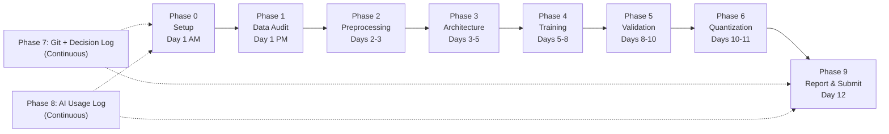

# 🛰️ Implementation Plan: Man-Made Change Detection from Sentinel-2 Imagery

> [!IMPORTANT]
> This plan covers every deliverable required by the assignment. Each phase maps directly to the "Required work" sections 1–7 plus the AI usage record and submission requirements.

---

## Data Overview

| Product | Sensing Date | Tile | Orbit | Pair Role |
|---|---|---|---|---|
| `S2A_...20221223...T43QBB` | 2022-12-23 | T43QBB | R005 | **Pair A – Before** |
| `S2A_...20230512...T43QBB` | 2023-05-12 | T43QBB | R005 | **Pair A – After** |
| `S2A_...20231006...T43RGM` | 2023-10-06 | T43RGM | R105 | **Pair B – Before** |
| `S2A_...20261022...T43RGM` | 2026-10-22 | T43RGM | R105 | **Pair B – After** |

Two valid temporal change-detection pairs exist:
- **Pair A** (T43QBB): Dec 2022 → May 2023 (~5 months, winter→spring, same orbit)
- **Pair B** (T43RGM): Oct 2023 → Oct 2026 (~3 years, same season, same orbit)

Cross-tile comparison (T43QBB vs T43RGM) is generally **not valid** for pixel-level change detection since the tiles cover different geographic areas, though the system should document the spatial overlap (if any).

---

## Phase 0 — Project Scaffolding & Environment Setup
**Deliverable:** Git repo with reproducible environment  
**Time estimate:** Day 1 morning

### Tasks
1. **Initialize Git repo** with meaningful `.gitignore` (exclude `.SAFE` imagery, `.zip`, large model weights)
2. **Directory structure:**
   ```
   man-made-change-detection/
   ├── configs/               # YAML configs for experiments
   ├── data/
   │   ├── raw/               # Symlinks or paths to .SAFE products
   │   ├── processed/         # Preprocessed GeoTIFFs
   │   ├── labels/            # Annotation files (GeoJSON/shapefiles)
   │   └── manifests/         # Data version manifests
   ├── notebooks/             # EDA and visualization notebooks
   ├── src/
   │   ├── preprocessing/     # Band loading, atmospheric correction, co-registration
   │   ├── features/          # Index computation (NDVI, NDBI, NDWI, etc.)
   │   ├── models/            # Model architecture definitions
   │   ├── training/          # Training loops, losses, augmentation
   │   ├── inference/         # Inference pipeline (onboard + ground)
   │   ├── quantization/      # Quantization scripts
   │   ├── evaluation/        # Metrics, visualization, reporting
   │   └── utils/             # I/O, geo-utilities, logging
   ├── outputs/
   │   ├── maps/              # Georeferenced change maps
   │   ├── evidence/          # Before/after comparison images
   │   ├── models/            # Saved model artifacts (original + quantized)
   │   └── reports/           # Experiment logs, metrics tables
   ├── tests/                 # Unit tests
   ├── docs/
   │   ├── TECHNICAL_REPORT.md
   │   └── DECISION_LOG.md
   ├── AI_USAGE.md
   ├── requirements.txt / pyproject.toml
   ├── Makefile / run.sh
   └── README.md
   ```
3. **Environment specification:**
   - Python 3.10+
   - Key packages: `rasterio`, `rioxarray`, `geopandas`, `shapely`, `pyproj`, `scikit-image`, `opencv-python`, `glymur` (JPEG2000), `torch` / `torchvision`, `segmentation-models-pytorch`, `onnxruntime`, `matplotlib`, `wandb` (or `mlflow`)
   - Pin versions in `requirements.txt` with hashes
   - Record CUDA version, OS, and hardware specs
4. **Set random seeds** everywhere (numpy, torch, python random) and document them
5. **Create `data/manifests/`** with SHA-256 checksums of all `.SAFE` products

---

## Phase 1 — Data Audit & Requirements (Assignment §1)
**Deliverable:** Data requirements document in technical report  
**Time estimate:** Day 1 afternoon

### Tasks

#### 1.1 Metadata Extraction
- [x] Parse `MTD_MSIL1C.xml` from all 4 products: extract sensing time, orbit, tile, processing baseline, cloud cover %, sun angles
- [x] Parse `MTD_TL.xml` (tile-level): extract tile footprint polygon (WGS-84), spatial reference, radiometric offsets
- [x] Parse `QI_DATA/` XML: extract quality flags (format correctness, geometric quality, radiometric quality, sensor quality)
- [x] Tabulate results in a comparison matrix in `docs/PHASE_1_DATA_AUDIT.md`

#### 1.2 Band Selection Justification
| Purpose | Bands | Resolution | Justification |
|---|---|---|---|
| Built-up detection | B02, B03, B04, B08, B11, B12 | 10–20m | High reflectance contrast for impervious surfaces |
| Vegetation masking | B04, B08 (NDVI); B05, B06, B07, B8A (red-edge) | 10–20m | Separate seasonal vegetation from structural change |
| Water masking | B03, B08 (NDWI); B03, B11 (MNDWI) | 10–20m | Exclude water-level fluctuations |
| Cloud/shadow masking | B01, B02, B10 + QI masks | 60m/10m | Filter unreliable pixels |
| Bare soil / urban | B11, B08 (NDBI); B12 as an additional SWIR feature | 10–20m | NDBI is (B11 − B08) / (B11 + B08); use other features to help separate construction from bare soil |

**Working resolution:** Resample all bands to **10m** using bilinear (continuous) or nearest-neighbor (masks) interpolation. Justify in report.

#### 1.3 Identify Data Gaps
- [ ] Cloud/shadow coverage per tile — metadata cloud assessment is recorded; per-pixel usable coverage remains for preprocessing
- [ ] Atmospheric quality (haze, cirrus from B10)
- [x] Check expected band file presence and supplied quality reports; full JP2 decode/integrity validation remains
- [x] Seasonal context: Dec (winter/dry) vs May (spring/green) for Pair A; Oct vs Oct for Pair B
- [x] Identify additional data needs: OSM building footprints, date-appropriate reference imagery/records, optional DEM, and land-cover context

#### 1.4 Computational Resources
- [x] Document available GPU/CPU, RAM, storage
- [ ] Estimate processing time per phase after representative processing/model benchmarks
- [x] Record preliminary onboard vs ground hardware assumptions; confirm target hardware in Phase 3

---

## Phase 2 — Preprocessing & Registration (Assignment §2)
**Deliverable:** Co-registered, radiometrically normalized image pairs  
**Time estimate:** Days 2–3

### 2.1 Band Loading & Stacking
- [x] Implement JPEG2000 band loading using `rasterio`
- [x] Implement metadata-based radiometric scaling; L1C uses per-band `RADIO_ADD_OFFSET` and `QUANTIFICATION_VALUE`, while Sen2Cor output uses `BOA_ADD_OFFSET` and `BOA_QUANTIFICATION_VALUE`
- [x] Implement six-band GeoTIFF stacks with CRS and transform metadata
- [x] Implement 20m-to-10m reflectance resampling (bilinear) and SCL resampling (nearest); no 60m bands are included in the initial stack
- [x] Run preparation for all four products and record metadata/coverage summaries; visual reflectance review remains

### 2.2 Atmospheric Correction (L1C → Surface Reflectance)
- [x] Select Sen2Cor (ESA's atmospheric correction processor) to produce L2A bottom-of-atmosphere reflectance
- [x] Implement subprocess execution via the supplied `L2A_Process.bat`, with per-product outputs and logs
- [x] Run Sen2Cor on all four products and review logs / L2A metadata
- [ ] Compare reflectance over invariant targets and decide if further relative normalization is needed

### 2.3 Cloud & Shadow Masking
- [x] Implement use of Sen2Cor scene classification output for invalid-pixel masking
- [x] Implement per-date validity masks for nodata, defective pixels, cloud shadow, unclassified, cloud, cirrus, and snow
- [ ] Review Sen2Cor SCL masks against imagery and decide if additional spectral/shadow screening is needed
- [x] Report measured SCL-valid area per image; visual mask review remains

### 2.4 Geometric Co-registration
- [ ] **Within-tile pairs** (same MGRS tile): images should already share the same UTM grid, but sub-pixel misalignment is expected
- [x] Implement ORB tie-point extraction and robust affine estimation with RANSAC
- [x] Implement warping of the later observation to the earlier observation's grid
- [ ] **Measure registration error:** review the per-pair tie-point RMSE/median and independent stable check points; geometric metadata's ~20m absolute-location value is not a substitute
- [ ] **Cross-tile consideration:** compute geographic overlap between T43QBB and T43RGM footprints. If no overlap, document this and proceed with within-tile pairs only
- [x] **False detection risk:** document how 1-pixel misregistration at 10m creates edge artifacts that mimic building-scale changes

### 2.5 Resolution Harmonization
- [x] Implement shared 10m grids and a common-valid mask for each same-tile pair
- [x] Implement registered GeoTIFF output with transform and registration metrics
- [x] Run pair registration and record residual/coverage measurements; visual output and independent check-point review remain

---

## Phase 3 — Model Architecture (Assignment §3)
**Deliverable:** Architecture design document + implemented model(s)  
**Time estimate:** Days 3–5

### 3.1 Architecture Selection

#### Ground Model (full inference on server/workstation)
- **Architecture:** Siamese U-Net (or FC-Siam-Diff / FC-Siam-Conc from [Daudt et al. 2018])
  - Two weight-sharing encoders process bi-temporal image pair
  - Decoder produces per-pixel change probability map
  - Multi-class output: {no_change, construction, demolition, road, bridge, infrastructure_other, uncertain}
- **Backbone:** ResNet-34 or EfficientNet-B2 (pretrained on ImageNet, fine-tuned)
- **Input:** 2 × (H × W × C) where C = selected bands (6–10 bands at 10m)
- **Output:** (H × W × num_classes) probability map

#### Onboard Model (edge inference on satellite/UAV)
- **Architecture:** Lightweight Siamese encoder with MobileNetV3-Small backbone
  - Reduced channel width (0.5× multiplier)
  - Binary output: {change, no_change} (defer classification to ground)
- **Constraints:**
  - < 5M parameters
  - < 500MB peak memory
  - < 2W power budget (assume NVIDIA Jetson Nano or Intel Movidius)
  - Inference latency < 5s per 256×256 tile
- **Proxy hardware:** Run benchmarks on Jetson Nano (if available) or simulate with CPU-only ONNX Runtime with memory profiling

#### Architecture Comparison Table
| Property | Ground Model | Onboard Model |
|---|---|---|
| Backbone | ResNet-34 / EfficientNet-B2 | MobileNetV3-Small |
| Parameters | ~24M | ~3M |
| Input bands | 6–10 | 4 (B02, B03, B04, B08) |
| Output classes | 6 + uncertain | 2 (binary) |
| Target hardware | GPU server | Edge accelerator |
| Expected latency | < 1s/tile (GPU) | < 5s/tile (edge) |

### 3.2 Implementation
- [x] Implement custom shared-weight Siamese U-Net in PyTorch for six-band, seven-class ground inference
- [x] Implement half-width MobileNetV3-Small Siamese variant for four-band binary onboard proposals
- [x] Verify forward pass with dummy input; profile parameters, FLOPs, CPU latency, and sampled memory on 256×256 patches
- [x] Document architectural tradeoffs and profiling caveats in `docs/PHASE_3_ARCHITECTURE.md`

---

## Phase 4 — Training & Hyperparameter Tuning (Assignment §4)
**Deliverable:** Trained models with experiment logs  
**Time estimate:** Days 5–8

### 4.1 Training Data Preparation

#### Label Generation Strategy
Since the assignment provides **no ground-truth labels**, we must create them:

1. **Semi-automatic annotation:**
   - Compute multi-index difference maps (NDVI diff, NDBI diff, brightness diff)
   - Apply thresholding to generate candidate change regions
   - Manually review and annotate using QGIS or Label Studio
   - Cross-reference with OSM building/road data (if dates align)
2. **External datasets for pre-training / transfer learning:**
   - LEVIR-CD (building change detection dataset, 256×256 patches, Sentinel/GE imagery)
   - WHU Building Change Detection Dataset
   - OSCD (Onera Satellite Change Detection, actual Sentinel-2 pairs)
   - S2Looking dataset
3. **Annotation schema (GeoJSON):**
   ```json
   {
     "type": "Feature",
     "properties": {
       "change_class": "construction",
       "confidence": "high",
       "annotator": "human",
       "notes": "new building footprint visible"
     },
     "geometry": { "type": "Polygon", "coordinates": [...] }
   }
   ```

#### Patch Extraction
- [x] Implement windowed dataset reader for six-band annotated patches with common-valid masking and ignore-index handling
- [x] Generate 10 km macro-block grids and empty city-specific polygon annotation layers for the T43QBB Mumbai and T43RGM Delhi raster footprints; grids are not yet clipped to verified municipal AOIs
- [ ] Tile co-registered image pairs into 256×256 patches at 10m resolution
- [ ] Stratified sampling: ensure balanced representation of change/no-change
- [ ] Geographic split: assign whole ~10×10 km macro-blocks from both cities to train/val/test before patching; keep same-location dates in one split
- [ ] Target approximately 70% train / 15% validation / 15% conventional test by labeled area, with a 2 km no-use buffer between split zones; additionally reserve one untouched zero-shot geographic test block per city

**Current blocker:** no reviewed labels exist yet. Training, class balancing, and hyperparameter search must wait until annotations and spatially separated validation/test splits are prepared. Current product metadata gives T43QBB a 140-day (2022-12-23 to 2023-05-12) gap and T43RGM a 1,112-day (2023-10-06 to 2026-10-22) gap. This appears consistent with Mumbai (T43QBB) and Delhi (T43RGM), respectively, based on the MGRS latitude bands and stated study areas; verify the exact AOI footprints before labeling. See `docs/PHASE_4_TRAINING.md`.

### 4.2 Training Configuration

| Hyperparameter | Baseline | Search Range |
|---|---|---|
| Learning rate | 1e-4 | [1e-5, 1e-3] log-uniform |
| Batch size | 16 | {8, 16, 32} |
| Optimizer | AdamW | {Adam, AdamW, SGD+momentum} |
| Weight decay | 1e-4 | [1e-5, 1e-3] |
| Loss function | BCE + Dice (weighted) | {BCE, Focal, Dice, Combo} |
| Augmentation | Flip + Rotate + Color jitter | ± Elastic, Cutout, MixUp |
| Epochs | 100 | Early stopping patience=15 |
| Scheduler | CosineAnnealing | {Step, Cosine, OnePlateau} |

### 4.3 Class Imbalance Handling
- [ ] Compute class pixel frequencies across training set
- [ ] Apply inverse-frequency class weights to loss function
- [ ] Use Focal Loss (γ=2) to down-weight easy negatives
- [ ] Oversample rare change classes during patch extraction
- [ ] **Specifically audit false positives from:** seasonal vegetation, tidal/water changes, cloud/shadow, haze, and illumination; use indices as supporting features/evidence, not automatic ground-truth gates

### 4.4 Hyperparameter Search
- [ ] Use Optuna or Ray Tune for systematic search (Bayesian optimization)
- [ ] Run ≥ 20 trials with different configurations
- [ ] Compare against baseline (default hyperparameters) using validation F1
- [ ] Log all experiments to W&B / MLflow with full config + metrics
- [ ] Produce comparison table and select best config with justification

### 4.5 Training Execution
- [ ] Train ground model with best config
- [ ] Train onboard model with knowledge distillation from ground model (optional)
- [ ] Save checkpoints at best validation epoch
- [ ] Record training curves (loss, precision, recall, F1 per class)

---

## Phase 5 — Change Analysis & Validation (Assignment §5)
**Deliverable:** Detection register, metrics report, evidence gallery  
**Time estimate:** Days 8–10

### 5.1 Inference Pipeline
- [ ] Run trained model on full co-registered image pairs (tiled inference with overlap to avoid boundary artifacts)
- [ ] Post-processing:
  - Morphological operations (opening/closing) to clean small noise
  - Connected component analysis to extract individual change objects
  - Minimum area threshold (e.g., 200 m² ≈ 2 pixels at 10m) to suppress noise
  - Vectorize change polygons with georeferencing

### 5.2 Evaluation Metrics
| Metric | Scope | Purpose |
|---|---|---|
| Precision | Per-class & overall | False positive rate |
| Recall | Per-class & overall | Missed detections |
| F1 Score | Per-class & overall | Harmonic mean |
| IoU / Jaccard | Per-class & overall | Spatial overlap quality |
| Kappa coefficient | Overall | Agreement beyond chance |
| Area Under PR Curve | Overall | Threshold-independent quality |
| Spatial accuracy | Per-detection | Centroid / boundary offset |

### 5.3 Detection Register
Create a GeoJSON/GeoPackage with fields:
- [ ] `detection_id`: Unique ID
- [ ] `geometry`: Polygon (WGS-84)
- [ ] `change_class`: {construction, demolition, road, bridge, infrastructure_other, uncertain}
- [ ] `confidence`: [0, 1] model probability
- [ ] `area_m2`: Estimated changed area in m²
- [ ] `length_m`: For linear features (roads, bridges) — estimated length
- [ ] `pair`: Which image pair (A or B)
- [ ] `status`: {accepted, rejected, uncertain}
- [ ] `rejection_reason`: For rejected — {vegetation, water, shadow, registration_artifact, agriculture, erosion}

### 5.4 Evidence Gallery
For each category, produce before/after comparison panels:

- [ ] **Accepted detections** (≥ 10 examples): before image, after image, change mask overlay, with location coordinates and class label
- [ ] **Rejected apparent changes** (≥ 5 examples): same format, with explanation of why rejected (e.g., "seasonal NDVI change", "water level drop", "shadow angle difference")
- [ ] **Failure cases** (≥ 3 examples): detections the model got wrong, with analysis of why
- [ ] **Uncertain regions**: areas where evidence is insufficient

### 5.5 Temporal Limitations
- [ ] Document what 2 dates can vs cannot establish:
  - ✅ Presence/absence of structures
  - ✅ Approximate timing window of change
  - ❌ Exact change date
  - ❌ Whether change is permanent
  - ❌ Construction vs renovation
- [ ] Explain what additional observations would resolve

---

## Phase 6 — Model Quantization (Assignment §6)
**Deliverable:** Quantized model artifacts + comparison report  
**Time estimate:** Day 10–11

### 6.1 Quantization Method Selection
- [ ] **Primary:** Post-Training Quantization (PTQ) — INT8 static quantization via PyTorch quantization API or ONNX Runtime
- [ ] **Secondary (optional):** Quantization-Aware Training (QAT) for better accuracy preservation
- [ ] **Export path:** PyTorch → ONNX → ONNX Runtime INT8

### 6.2 Calibration
- [ ] Select calibration dataset: 100–500 representative patches from validation set
- [ ] Run calibration to compute activation ranges
- [ ] Document calibration data selection criteria

### 6.3 Comparison Report

| Metric | Original (FP32) | Quantized (INT8) | Δ |
|---|---|---|---|
| Model file size (MB) | — | — | — |
| Parameter count | — | — | — |
| F1 score (overall) | — | — | — |
| Precision (per class) | — | — | — |
| Recall (per class) | — | — | — |
| IoU (per class) | — | — | — |
| Peak memory (MB) | — | — | — |
| Inference latency (ms/tile) | — | — | — |
| Sensitivity to small changes | — | — | — |

- [ ] Identify any change classes disproportionately affected by quantization
- [ ] Document supported/unsupported operations
- [ ] State deployment limitations (e.g., "INT8 GEMM not supported on target NPU")

---

## Phase 7 — Reproducibility & Decision Records (Assignment §7)
**Deliverable:** Complete Git history + decision log + reproducible instructions  
**Time estimate:** Ongoing (throughout) + Day 11 final cleanup

### 7.1 Git Practices
- [ ] Meaningful commit messages following conventional commits (`feat:`, `fix:`, `docs:`, `exp:`)
- [ ] Tag key milestones: `v0.1-preprocessing`, `v0.2-baseline`, `v0.3-tuned`, `v1.0-final`
- [ ] Never commit large binary files (use `.gitignore`, reference via manifest)

### 7.2 Decision Log (`docs/DECISION_LOG.md`)
Document every significant decision:
```markdown
## DECISION-001: Atmospheric correction method
- **Date:** YYYY-MM-DD
- **Options:** Sen2Cor L2A, DOS, Relative normalization
- **Decision:** DOS with pseudo-invariant feature calibration
- **Rationale:** Sen2Cor requires specific installation; DOS is sufficient for
  relative change detection. Cross-validated against 5 invariant targets.
- **Alternatives rejected:** Sen2Cor (installation complexity), raw L1C (TOA
  reflectance varies with atmosphere)
```

### 7.3 Reproducibility Package
- [ ] `requirements.txt` with pinned versions
- [ ] `Makefile` or `run.sh` with targets: `preprocess`, `train`, `evaluate`, `quantize`, `demo`
- [ ] Data manifest with checksums
- [ ] Random seed configuration
- [ ] Hardware/software specification
- [ ] Step-by-step README with expected outputs

---

## Phase 8 — AI Usage Record (Assignment requirement)
**Deliverable:** `AI_USAGE.md`  
**Time estimate:** Ongoing + Day 11 final

- [ ] Record every AI interaction: tool name, model, timestamp, full prompt, full response
- [ ] Include code generation, debugging, conceptual questions
- [ ] Include this planning session
- [ ] Format chronologically with session markers

---

## Phase 9 — Technical Report & Final Assembly (Submission)
**Deliverable:** Complete submission package  
**Time estimate:** Day 12

### 9.1 Technical Report Structure
```
1. Introduction & Problem Statement
2. Data Audit & Requirements (Phase 1)
3. Preprocessing & Registration (Phase 2)
   3.1 Atmospheric correction
   3.2 Cloud masking
   3.3 Co-registration & error analysis
4. Model Architecture (Phase 3)
   4.1 Ground model
   4.2 Onboard model
   4.3 Deployment assumptions
5. Training & Experiments (Phase 4)
   5.1 Label generation
   5.2 Training configuration
   5.3 Hyperparameter search results
   5.4 Class imbalance analysis
6. Results & Validation (Phase 5)
   6.1 Detection performance metrics
   6.2 Change register summary
   6.3 Error analysis
   6.4 Temporal limitations
7. Model Quantization (Phase 6)
8. Discussion & Limitations
9. Reproducibility Guide
Appendix A: Decision Log
Appendix B: Full Metrics Tables
Appendix C: Evidence Gallery
```

### 9.2 Final Submission Checklist
- [ ] Source repository with complete implementation and version history
- [ ] Technical report (PDF/MD)
- [ ] Original model artifacts (`.pth` + `.onnx`)
- [ ] Quantized model artifacts (`.onnx` INT8)
- [ ] Configs (YAML) for all experiments
- [ ] Georeferenced change outputs (GeoJSON/GeoPackage + GeoTIFF masks)
- [ ] Detection register (GeoJSON with all fields)
- [ ] Before/after evidence images
- [ ] Reproducible demo script
- [ ] `AI_USAGE.md` with full chat records
- [ ] `README.md` with setup and execution instructions

---

## Execution Timeline



---

## Key Risk Mitigations

| Risk | Impact | Mitigation |
|---|---|---|
| No ground-truth labels provided | Cannot train/evaluate supervised model | Pre-train on OSCD/LEVIR-CD datasets; semi-auto annotation with manual review |
| Cloud cover obscures key areas | Reduced usable coverage | Check cloud masks early; report % usable area; flag unreliable regions |
| Cross-tile pairs have no spatial overlap | Only 2 pairs instead of 6 | Focus on within-tile pairs (A and B); document overlap analysis |
| Sub-pixel misregistration | False change edges | Measure and report registration RMSE; apply minimum-area filter; document false detection analysis |
| Class imbalance (change is rare) | Model predicts "no change" everywhere | Focal loss, oversampling, class weights, patch stratification |
| Onboard hardware not available | Cannot measure real latency/power | Use CPU-only proxy with profiling; clearly separate measurements from estimates |
| Limited training data from 2 pairs | Overfitting | Transfer learning from external datasets; strong augmentation; cross-validation |

> [!TIP]
> **Highest-leverage actions first:** Get preprocessing and co-registration right before any modeling work. A poor registration will invalidate everything downstream. Start Phase 2 as early as possible and validate with visual checks.
