# Evidence gallery

Method: `ground_ce_final` · change map: `ground_fp32`. Panels: T1 | T2 | T2 + model outline (red gain, cyan loss). True colour B04/B03/B02, shared stretch per window; 10 m pixels, 2.56 km windows. Human labels come from the blind two-date review.

## Accepted (16 windows)

- **T43RGM_R06516_C03516** (Delhi, test): human `construction`; model gain 1143 px / loss 20 px, flagged=True. 

  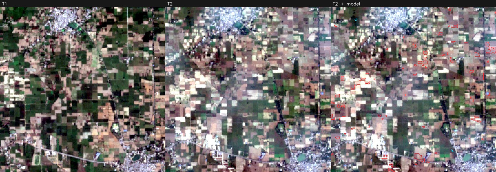

- **T43RGM_R03516_C03260** (Delhi, zero_shot): human `construction`; model gain 172 px / loss 0 px, flagged=True. 

  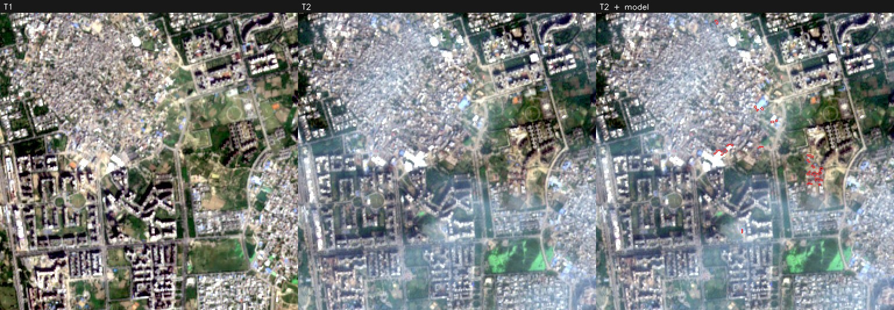

- **T43RGM_R00260_C06260** (Delhi, test): human `road`; model gain 202 px / loss 0 px, flagged=True. 

  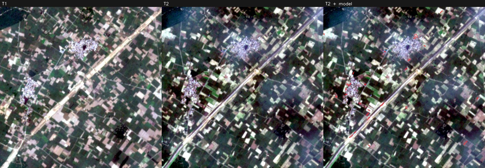

- **T43RGM_R08004_C05260** (Delhi, test): human `construction`; model gain 240 px / loss 0 px, flagged=True. 

  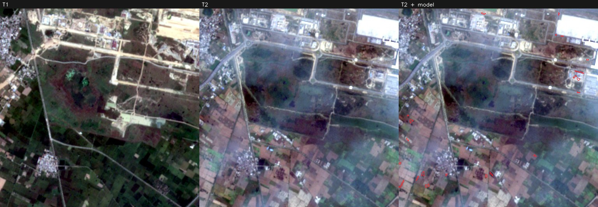

## Rejected natural (58 windows)

- **T43RGM_R04004_C01004** (Delhi, test): human `natural_vegetation`; model gain 8 px / loss 0 px, flagged=False. 

  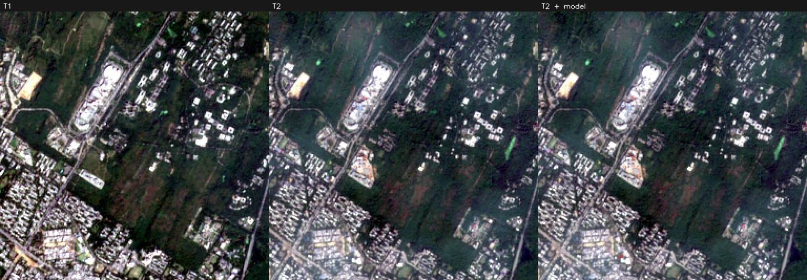

- **T43RGM_R03260_C01260** (Delhi, test): human `natural_vegetation`; model gain 6 px / loss 40 px, flagged=False. 

  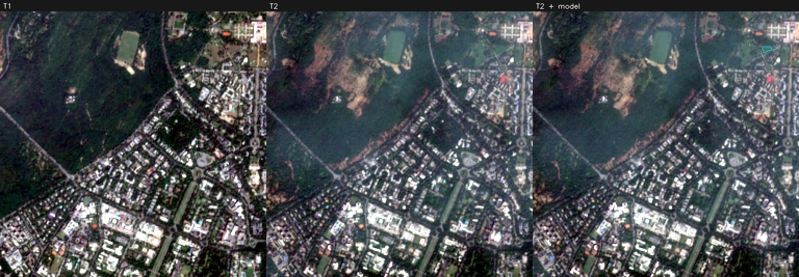

- **T43RGM_R01260_C00004** (Delhi, test): human `natural_vegetation`; model gain 86 px / loss 0 px, flagged=False. 

  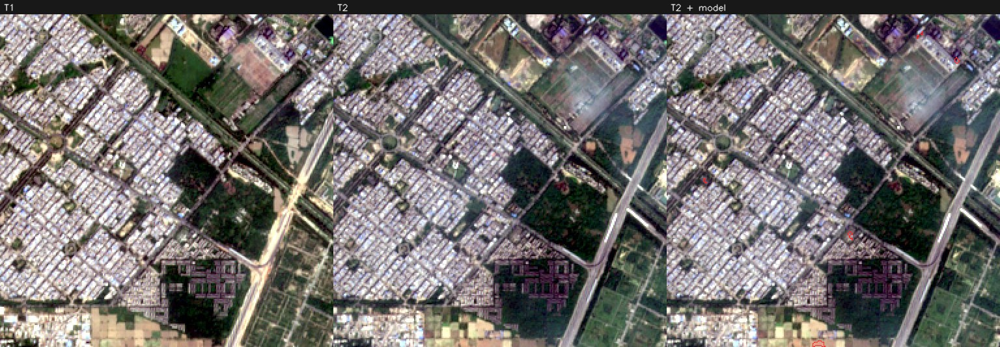

- **T43RGM_R01004_C00004** (Delhi, test): human `natural_vegetation`; model gain 37 px / loss 0 px, flagged=False. 

  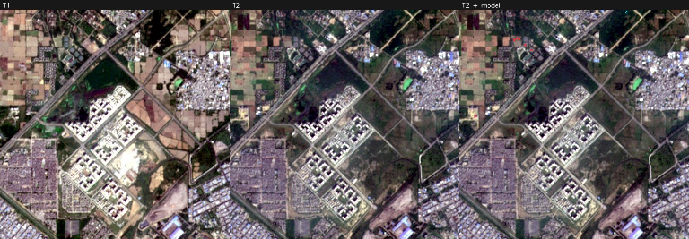

## Failure false alarm (160 windows)

- **T43RGM_R05516_C07004** (Delhi, test): human `acquisition_artifact`; model gain 984 px / loss 11 px, flagged=True. 

  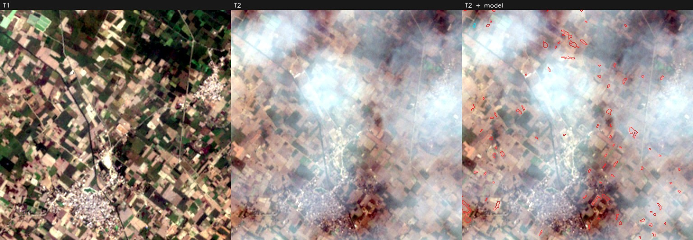

- **T43QBB_R04002_C08258** (Mumbai, test): human `natural_vegetation`; model gain 1183 px / loss 0 px, flagged=True. 

  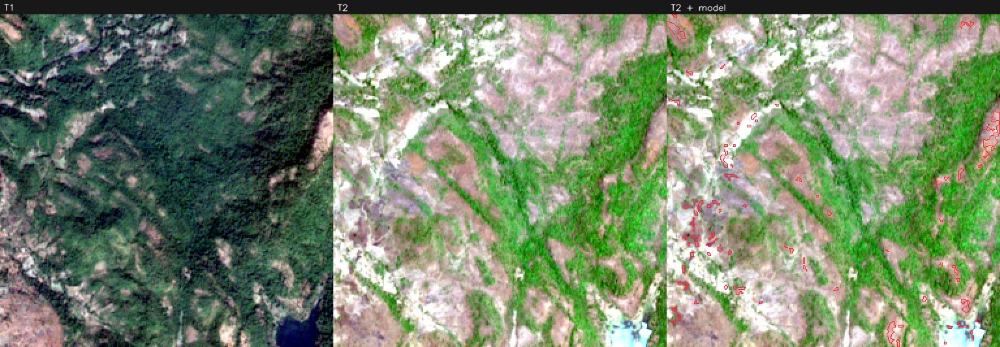

- **T43QBB_R06514_C07002** (Mumbai, test): human `natural_vegetation`; model gain 1194 px / loss 32 px, flagged=True. 

  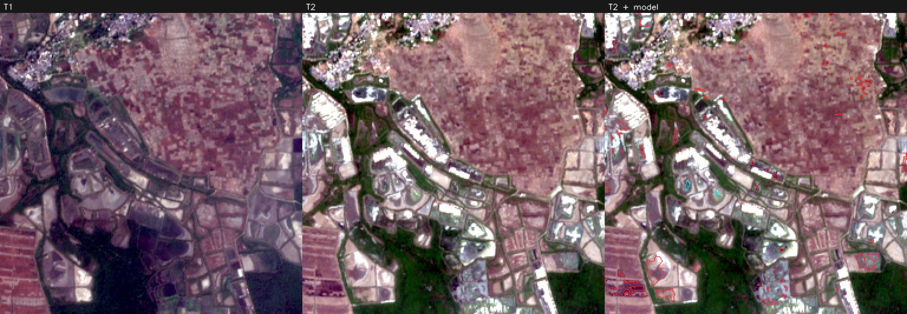

- **T43RGM_R04516_C08260** (Delhi, test): human `natural_vegetation`; model gain 1070 px / loss 17 px, flagged=True. 

  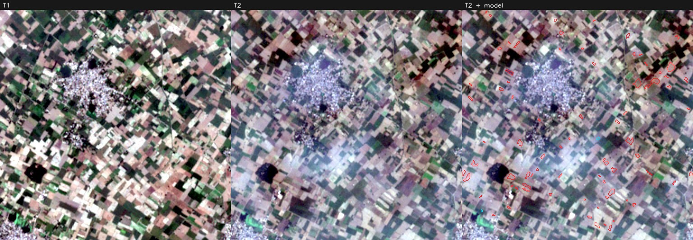

## Failure missed (8 windows)

- **T43RGM_R05260_C02004** (Delhi, test): human `road`; model gain 0 px / loss 5 px, flagged=False. 

  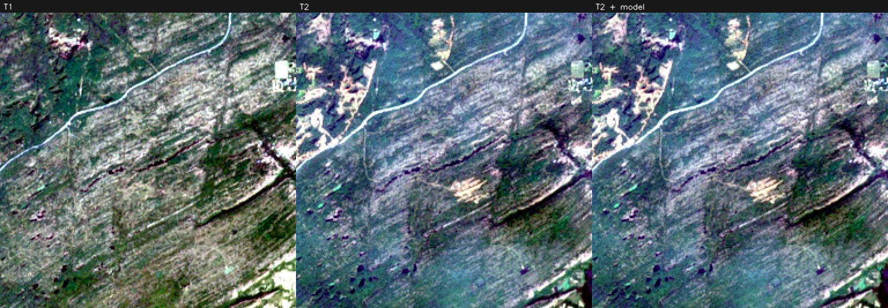

- **T43RGM_R03260_C03260** (Delhi, zero_shot): human `construction`; model gain 52 px / loss 0 px, flagged=False. 

  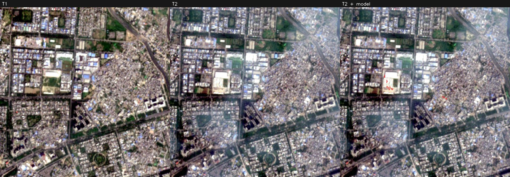

- **T43RGM_R04260_C02260** (Delhi, train): human `construction`; model gain 42 px / loss 0 px, flagged=False. 

  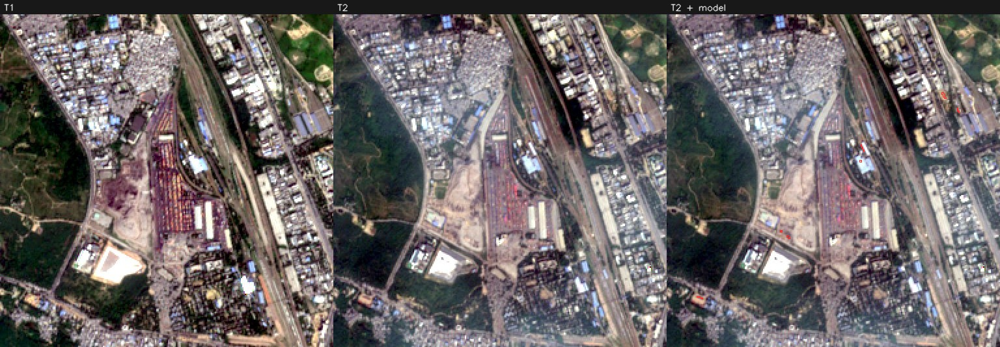

- **T43RGM_R02004_C02260** (Delhi, train): human `road`; model gain 4 px / loss 0 px, flagged=False. 

  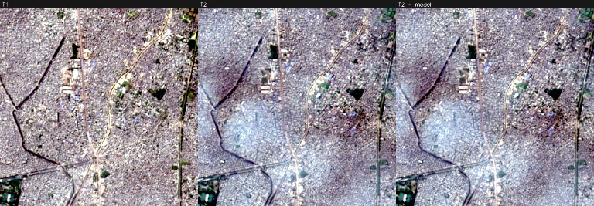

## Uncertain (62 windows)

- **T43QBB_R06002_C01514** (Mumbai, test): human `uncertain`; model gain 0 px / loss 0 px, flagged=False. 

  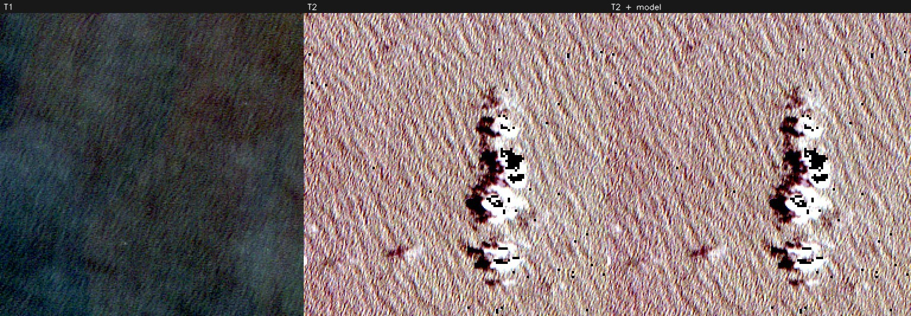

- **T43QBB_R02514_C04002** (Mumbai, test): human `uncertain`; model gain 0 px / loss 0 px, flagged=False. 

  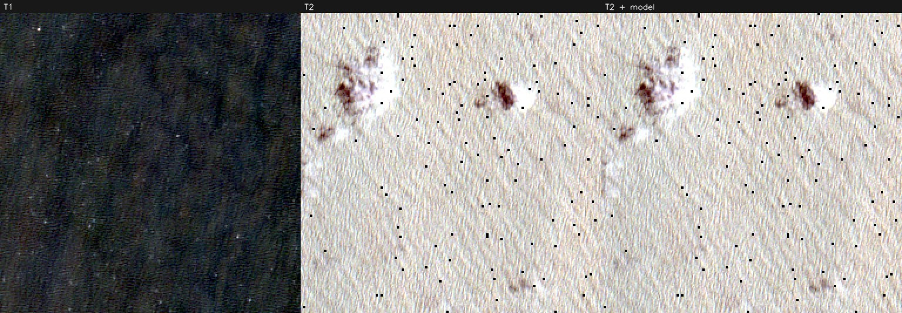

- **T43QBB_R07002_C02514** (Mumbai, test): human `uncertain`; model gain 0 px / loss 0 px, flagged=False. 

  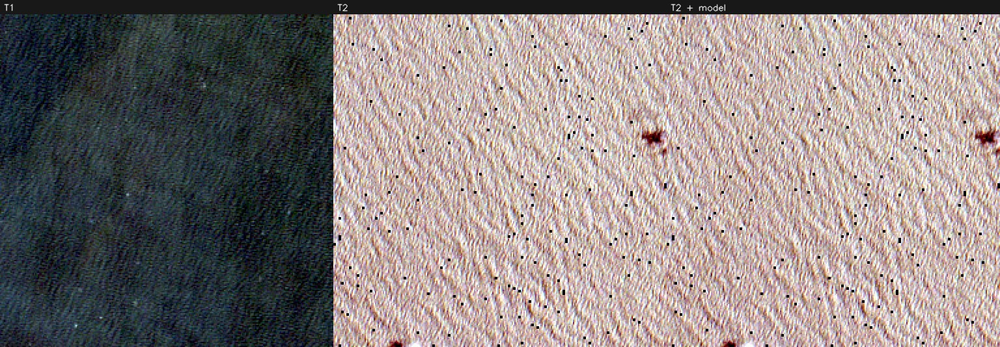

- **T43QBB_R03258_C04514** (Mumbai, test): human `uncertain`; model gain 0 px / loss 0 px, flagged=False. 

  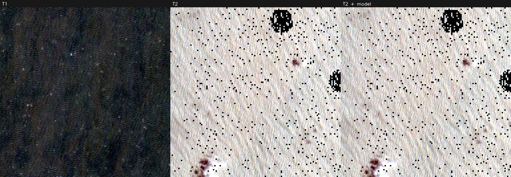
